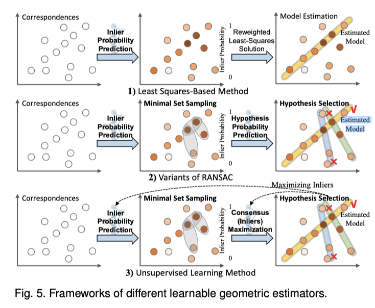

# 图像匹配
支撑了众多应用，包括图像检测，视觉定位、三维重建、运动恢复结构、同步定位与建图（SLAM）、新视角合成等。
图像匹配最终呈现二维图像之间的三维关系。

## 一、传统方法
检测描述器，离群点滤波器，几何估计器。是前后串联的三道工序，一道给下一道交结果。

包括用于提升特征表示能力的检测-描述子、在复杂条件下实现可靠匹配的离群点滤波器，以及用于鲁棒位姿推断的几何估计器。

尽管在温和条件下效果良好，但在光照剧烈变化、大视角变化、纹理稀疏、图案重复或遮挡等情况下通常失效。
这是传统检测 - 描述器方案最大的短板，也是后来深度学习图像匹配（SuperPoint、LoFTR 等）想要解决的问题。
### 1.1 检测描述器
目标：提取更稳定、区分度更高的局部特征。提升特征表示能力。
局限：仅依靠外观信息，无法区分“外观相似但空间不匹配”的假匹配。

输入两张图片
输出：图 A 的关键点 + 每个关键点的描述向量；图 B 的关键点 + 描述向量

识别两张图里面，属于现实世界同一地方的纹理/区域。
检测器负责在图片上到处找 “有辨识度的关键点”
描述器给每个关键点周边的纹理、边缘，编码成一串数字向量。

做完之后，拿 A 图每一份档案，去 B 图找档案最像的那一个，生成一大堆初步配对。输出一堆候选配对，里面混杂大量假配对（误匹配）。

输出产物：粗匹配对（真的匹配 + 一大堆错误匹配混在一起）

**关键点是什么？**
直接拿整张图片一块一块区域对比，计算量巨大，而且很多区域重复、没用。于是算法就只挑选图像上最有辨识度的局部小位置，这就是关键点。
关键点一般选：角点、斑点（纹理突变的地方），比如墙角、物体边缘；
每个关键点，都附带一小块周围的局部纹理区域；
再用描述子，把这块纹理压缩成一串数字向量，用来跨图比对，判断是不是同一个区域。

**把这块纹理压缩成一串数字向量的操作是随机的吗？**
- 不是随机，而是按固定规则：只要图像纹理不变，算法参数不变，算出来向量就固定。
- 如果两张图是**同一个物理区域**，就算图像稍微旋转、光照变化，最后得到的向量依然会很接近。
- 如果纹理完全不同，向量数值差别就很大。

### 1.2 特征匹配器
输入：两组关键点加描述子
任务：比较描述子之间的相似度，建立对应关系，输出一堆候选匹配对。

### 1.3 离群点滤波器
目标：清晰第一步输出的候选匹配，提出明显不合理的误匹配。实现复杂条件下可靠匹配。
局限：属于二维图像平面的局部约束，无法替代三维几何校验，不能清除全部误匹配。

不使用相机几何、不计算位姿。只看**匹配对之间局部空间位置关系**做粗筛。

### 1.4 几何估计器
目标：基于清洗后的匹配对，用对极几何约束，**求解相机相对位姿 (R,t)**，同时继续剔除剩下的离群点。三维全局几何校验，终审。实现鲁棒位姿推断。
局限：如果输入匹配的离群占比过高，几何估计依然会失效。

用物理空间规则终审，同时求解位姿。
算出相机的位姿：相机到底移动、旋转了多少，这就是SLAM定位需要的结果。

## 二、可学习检测描述子

### 2.1 可学习检测器
分步图像匹配严重依赖检测器-描述符技术来提取关键点，作为匹配的基本单元。由于该步骤在稀疏图像匹配中具有基础性和关键性，因此它往往是首批被重新审视并采用可学习替代方案加以重构的环节之一。
关键点不应落在瞬态结构或易受噪声干扰的区域上；此外，对应于同一物理结构或三维位置的关键点，应在不同视角下被一致地检测出来——这一特性称为重复性。这两项属性始终是基于学习的检测器发展的核心所在。

FAST——仅用像素灰度比较判断“是否为角点”，无需训练数据，但泛化弱；

关键点
CNN关键点检测器设计注重可靠性和可重复性。
TILDE通过极端光照变化图像训练，提升跨条件可重复性。
MagicPoint采用同源变换与强噪声（亮度、阴影、模糊、高斯/散斑噪声）增强鲁棒性。
Lenc等提出无监督回归框架，联合学习检测器与目标，并引入协方差约束实现视角不变的可重复性。
后续改进包括：Zhang等融合TILDE锚点提升定位可靠性；Key.Net融合手工与学习特征以适应多变条件。
新型架构进一步突破：NeSS-ST引入可学习评分器筛选最可靠的Shi-Tomasi关键点；旋转/尺度等变网络直接建模不变性，减少对数据增强的依赖。

### 2.2可学习描述子
不是泛泛而谈技术发展，而是围绕如何更好训练描述子这一核心问题，系统梳理迭代升级路径。
一、技术原理：什么是“描述符”（Descriptor）？
在计算机视觉中，“描述符”是指对图像局部区域（如角点、边缘附近）提取的数学特征向量，用于表征该区域的纹理、梯度等信息，以便后续进行匹配、识别或检索。
•	PCA-SIFT [52]：先用传统SIFT算法提取128维梯度直方图向量，再用**主成分分析**（PCA）降维（例如压缩到32维），保留主要变化方向，提升计算效率并增强对光照/噪声的鲁棒性。
▶ 示例：一张人脸眼睛角落的SIFT向量经PCA后，只保留最能区分“睁眼”与“闭眼”的32个关键维度，丢弃冗余信息。
•	LDA相关方法 [53–55]：不同于PCA仅关注“数据分散程度”，**线性判别分析**（LDA）强调“类间分离、类内紧凑”——即让不同类别（如“汽车vs行人”）的描述符尽量远离，同类样本尽量靠近。
▶ 示例：在交通标志识别中，LDA会拉大“禁止停车”与“限速60”两类描述符的距离，同时压缩各自内部差异，使分类更准确。
​
​
二、发展脉络：从“降维”到“判别”再到“二值化”
该段文字展现了局部描述符演化的三阶段趋势：
🔹 第一阶段：压缩与鲁棒性（PCA-SIFT）
→ 目标：减小存储/计算开销，抵抗轻微图像扰动。
→ 局限：未利用类别标签，无法区分相似但不同类的对象（如“苹果”和“番茄”）。
🔹 第二阶段：增强判别力（LDA投影 + 参数优化）[53–56]
→ 关键进步：引入监督信号（人工标注的类别），用LDA学习有区分性的子空间；再用Powell优化法自动调整LDA参数（如投影方向权重），进一步提升性能。
→ 类比：像教学生识字——PCA是“整理笔记”，LDA+Powell则是“划重点+反复练习错题”。
🔹 第三阶段：高效与轻量（二值化与稀疏化）[57–59]
→ LDAHash [57]：将实数描述符映射为短二进制码（如64位0/1串），直接在汉明空间（Hamming space）计算距离（只需异或+计数），速度极快，适合手机端实时匹配。
→ Boosted Binary Descriptor [58]：“Boosting”集成多个弱二值分类器，类似投票机制，显著提升精度与速度平衡。
→ 稀疏空间池化 [59]：用L1正则化自动筛选图像中最具判别力的局部区域（如只关注车牌而非车身背景），实现“注意力聚焦”，减少无效计算。
▶ 示例：监控视频中抓取车牌——稀疏池化自动忽略模糊的车灯区域，只处理清晰的字符区，节省90%计算资源。
​
​
三、核心目标：四大设计准则贯穿始终
所有方法均围绕以下统一目标优化：
✅ 紧凑性（Compactness）：降低维度（如128→32维）或转为二进制（如32位→16位），节省内存与带宽。
✅ 鲁棒性（Robustness）：对旋转、缩放、光照变化不敏感（PCA/LDA均具此特性）。
✅ 判别性（Discriminativeness）：确保不同类别的特征在空间中“分得开”（LDA的核心贡献）。
✅ 高效性（Efficiency）：二值化（LDAHash）、集成加速（Boosted）、区域筛选（L1稀疏）共同推动实时应用落地。
​
​
四、方法对比：关键差异一览表
| 方法          | 核心技术               | 输入类型   | 输出形式               | 优势                    | 典型场景                 |
|---------------|------------------------|------------|------------------------|-------------------------|--------------------------|
| PCA-SIFT [52] | 无监督PCA              | 实数向量   | 短实数向量             | 计算快、无需标签         | 大规模图像检索初筛        |
| LDA投影 [53]  | 监督式LDA              | 带标签向量 | 低维实数向量           | 分类精度高               | 有限类别识别（如医疗影像）|
| LDAHash [57]  | LDA + 二值映射         | 实数向量   | 二进制字符串           | 检索极快、存储极省       | 移动端AR、海量数据库搜索  |
| 稀疏池化 [59] | L1正则化 + 区域选择    | 图像块     | 关键区域坐标+描述符    | 抗遮挡、聚焦有效信息     | 复杂背景下的目标检测      |

二、方法演进：DeepCompare 与 MatchNet 如何改进传统Siamese结构？
| 方法          | 核心创新               | 监督方式   | 匹配判别               | 实际意义                    | 
|---------------|------------------------|------------|------------------------|-------------------------|
| DeepCompare [61] | 提出三种变体： • Basic-Siamese：标准双分支，共享全部权重； • Pseudo-Siamese：两分支结构相同但权重独立（提升表达灵活性）； • Central-Surround Two-Stream：一个分支处理目标中心区域，另一个处理周围上下文区域（模拟人类视觉注意机制） | 使用回归式监督（如L2损失最小化匹配对距离、最大化非匹配对距离） | L2距离（欧氏距离）作为相似度指标 | 首次系统探索Siamese架构在局部补丁描述上的多样性设计，强调空间关系建模（如中心-周边协同）。 |
| MatchNet [62] | 引入可学习的相似度度量模块（如全连接层+ReLU），替代固定L2；将匹配问题转化为二分类任务（“匹配” or “不匹配”） | 使用分类式监督：交叉熵损失（Cross-Entropy Loss），标签为0/1（真匹配/假匹配） | 网络输出一个[0,1]概率值，表示匹配置信度 | 将匹配决策显式建模为判别过程，使网络更关注判别边界，显著提升对困难负样本（如外观相似的不同物体）的区分能力。 |

三、核心局限：为何说“分类式监督仍弱化描述符判别性”？
尽管MatchNet比DeepCompare更先进，但两者共有的根本瓶颈在于：监督信号仅来自“匹配与否”的粗粒度标签，未强制要求描述符本身具备强区分能力。这导致三个典型问题：
•	⚠️ 描述符坍缩（Descriptor Collapse）：不同类别的补丁可能被映射到特征空间中邻近区域，只要它们“不匹配”，损失就很小——网络满足于“能区分开”，而非“学好本质特征”。
▶️ 例如：猫耳补丁与狗耳补丁虽属不同类别，但若从未出现在同一训练批次中作为负样本，网络可能赋予它们相似嵌入。
•	⚠️ 距离度量失配（Metric Mismatch）：L2距离或简单MLP相似度无法建模复杂语义差异（如光照变化、遮挡、尺度变形），而监督信号未引导网络学习更具鲁棒性的度量方式。
▶️ 例如：同一车牌在白天/夜晚图像中纹理差异极大，L2距离易失效，但交叉熵损失仍只告诉网络“这是匹配对”，不教它如何应对光照不变性。
•	⚠️ 缺乏细粒度约束：没有引入如三元组损失（Triplet Loss） 或N-pair损失等明确拉远正样本、拉近负样本的机制，描述符的类内紧凑性与类间分离性无法充分优化。
▶️ 后续工作如FaceNet即采用三元组损失，显著提升人脸描述符的判别力。

### 2.3 联合检测-描述框架
尽管各个模块均经过精心设计，但将检测器与描述子分别独立地集成到图像匹配流程中，会因忽略二者内在的依赖关系与信息共享，导致信息损失与优化目标不一致。因此，研究者提出了联合检测-描述框架，以克服上述难题。

将此类方法分为两类：级联结构——检测与描述按顺序执行；分支结构——检测与描述并行执行。
| 类型 | 代表方法 | 核心思想 | 关键点 |
|----|----|----|----|
|级联结构 |LIFT、LF-Net、RF-Net、ALIKE/ALIKED、D2-Net、ASLFeat、DISK|先检测 → 再裁剪/变换 → 后描述（顺序依赖）|检测与描述模块解耦或弱耦合；部分支持端到端（如LF-Net），部分需分阶段训练（如LIFT）；D2-Net等反向操作（先描述后检测）属变体
|分支结构|SuperPoint、R2D2、SFD2|共享骨干网络 + 并行检测头 & 描述头|联合训练、参数共享；依赖合成数据（MagicPoint）或强数据增强；强调特征一致性|
|解耦结构|DeDoDe、XFeat|检测与描述完全独立训练，仅在数据/目标|训练稳定、鲁棒性强；用3D轨迹/互近邻等外部信号监督|

### 2.4 可学习的异常值过滤器
上下文探索法
运动一致性引导法

### 2.5 可学习几何估计器
一、技术背景：为什么需要“可学习的几何估计器”？

在图像匹配（如两张照片对齐、三维重建、视觉定位）中，算法首先会生成大量候选点对应关系（putative correspondences）——例如SIFT或SuperPoint检测出的特征点配对。但其中常混入大量错误匹配（outliers），直接使用会导致几何模型（如基础矩阵F、单应矩阵H、本质矩阵E）严重失真。

传统方法（如DLT、RANSAC）虽能处理噪声，但存在明显短板：
•	✅ DLT（直接线性变换）：计算快，但完全不抗噪——1个错误匹配就可能让结果崩溃；
•	✅ RANSAC：鲁棒性强，但效率低且依赖人工设定阈值（如内点误差阈值、最大迭代次数），在复杂场景（弱纹理、运动模糊）下容易失效。
→ 因此，研究者转向可学习（learnable）的几何估计器：用神经网络自动学习“如何更聪明地加权、采样、筛选”，让模型既鲁棒又高效，还能泛化到新场景。

🔍 举例说明：
拍摄同一栋楼的两张倾斜照片，传统RANSAC可能随机采样到3个共线点（退化情况），拟合出错误的基础矩阵；而可学习方法（如NG-RANSAC）会先预测哪些点更可能是“真实内点”，优先采样高质量三元组，大幅提升成功率。
​
二、三类主流可学习估计器详解（对照图5框架）

|类别	|核心逻辑	|闭环|
|---|----|----|
加权最小二乘|	点加权，一步求解模型	|无
可学习 RANSAC 变体	|概率引导采样，对候选假设打分选择|	单向，无反馈
无监督学习方法|	采样 + 假设选择，再将模型共识信息反馈给内点预测，迭代优化	|✅闭环反馈|

▶ 3.3.1 基于最小二乘的方法（Least Squares-Based）
核心思想：不抛弃所有外点，而是给每个对应点动态分配可信度权重，迭代优化加权最小二乘解。
•	代表方法：DFM [127]
•	怎么做？
•	输入：原始点对 + 上一轮估计的模型（如基础矩阵F）；
•	网络（PointNet-like）分析每个点对的残差（residual）（即该点对是否符合当前F）和辅助信息（如局部描述子相似度、距离等）；
•	输出：每个点对的权重（0~1），高权重=更可信；
•	用这些权重重新解最小二乘问题，更新F；重复多轮 → 收敛到稳定解。
•	✅ 优势：端到端可微，训练稳定；天然支持软加权，比硬阈值更平滑。
•	❌ 局限：依赖初始模型质量，对严重退化场景（如纯旋转）敏感。

📌 类比理解：
就像老师批改作文——不直接删掉“跑题”的段落（硬剔除），而是根据逻辑连贯性、用词准确性给每段打分（权重），最后按分数加权计算总分（模型参数）。
​
​
▶ 3.3.2 RANSAC的可学习变体（Variants of RANSAC）
RANSAC的核心是“采样-评估-选择”，可学习方法主要在三个环节注入神经网络：
| 环节 | 传统做法 | 可学习改进 | 代表方法 | 关键创新 |
|------|----------|------------|----------|----------|
| ① 最小集采样 （Minimal Set Sampling） | 随机采样（如8点法选8个点） | 学习“哪里更可能出内点”，从高概率区域定向采样 | NG-RANSAC [130] | PointCN网络预测每个点的内点概率，采样时偏向高概率点组合 |
| ② 假设评估 （Hypothesis Scoring） | 计算内点数量（硬阈值判断） | 学习“哪个假设更优”，输出连续分数而非0/1 | DSAC [128], MQ-Net [135] | DSAC用软argmax加权融合所有假设；MQ-Net用残差直方图+CNN预测质量分 |
| ③ 迭代优化 （Adaptive Refinement） | 固定迭代次数或内点数阈值 | 动态调整采样策略与权重（如失败时降权、引入先验） | ARS-MAGSAC [131], BANSAC [132] | ARS-MAGSAC用贝叶斯规则更新概率；BANSAC建模为动态贝叶斯网络 |

•	其他重要进展：
•	∇-RANSAC [133]：用Gumbel-Softmax实现可微采样，避免随机性；加入相对位姿误差损失（旋转/平移）和对称极线误差损失，直面下游任务需求。
•	FSNet [137]：跳过显式点匹配！直接输入两张图像，用“极线交叉注意力”沿极线聚合特征，预测位姿误差——适用于特征匹配失败的场景（如重复纹理）。
⚙️ 技术亮点总结：
所有方法都实现了 “可微分”（支持反向传播），让几何估计成为深度学习流水线中可训练的一环，而非孤立后处理模块。
​
​
▶ 3.3.3 无监督学习方法（Unsupervised Learning Method）
核心思想：不依赖真实几何模型标签（如真值基础矩阵），仅利用图像一致性约束（如重投影误差、光度一致性）进行自监督训练。
•	典型思路：
•	构造一个可学习的几何模型（如神经网络参数化F）；
•	将图像A的点通过该模型映射到图像B，检查像素是否对齐（如SSIM、L1光度误差）；
•	最小化重投影误差 → 模型自动学会满足几何约束。
•	✅ 优势：无需昂贵真值标注（真实场景中难以获取精确F/E）；天然适配自监督预训练。
•	❌ 挑战：易陷入局部最优（如恒等变换），需精心设计损失函数与数据增强。

🌐 现实意义：
在自动驾驶数据采集车中，海量双目图像无法人工标注基础矩阵，无监督方法可直接利用行车视频自学习匹配规律。
​
​
三、为什么这些方法重要？——实际应用价值
•	提升鲁棒性：在低光照、动态模糊、弱纹理场景下，传统RANSAC失败率超40%，而NG-RANSAC可降至15%以下（见[130]实验）。
•	加速匹配流程：DSAC将RANSAC迭代次数从默认1000次降至200次，速度提升5倍，同时精度更高。
•	赋能端侧部署：∇-RANSAC的轻量网络+Gumbel采样，可在手机端实时运行（<30ms/对）。
•	打通多任务链路：如FSNet直接从图像到位姿，省去特征提取→匹配→RANSAC三阶段，减少误差累积。
​
​
四、当前局限与未来方向
•	局限性：
•	大多依赖高质量初始点对，若匹配本身错误率高（>70%），学习方法也难挽救；
•	对极端尺度/旋转变化（如无人机俯拍vs地面街景）泛化仍不足；
•	可解释性弱：网络为何给某点高权重？缺乏人类可理解的决策依据。
•	前沿趋势：
•	✅ 多模态融合：结合IMU、GPS先验提升几何估计稳定性；
•	✅ 神经符号混合：用符号几何规则（如八点法约束）作为网络正则项；
•	✅ 大模型协同：将几何估计作为视觉大模型（如VLA）的“空间推理插件”。


## 端到端匹配器
### 端到端稀疏匹配器
中端匹配器：接收已经检测好的关键点，**网络内部完成特征增强、跨图交互 + 可微分最优匹配一整套**。关键点检测在网络外部，匹配逻辑在网络内部。

为什么说不再割裂外观与空间坐标？
传统流水线**分两步独立处理**：先拿外观描述子做匹配，匹配完之后，才单独拿像素坐标做几何校验；外观、坐标是两套独立流程、互不通信，这就是**割裂**。
而中端稀疏匹配器（SuperGlue 这类），**从最开始就把外观描述子和空间坐标融合进同一个特征向量，一起送入 Transformer 注意力模块联合建模**，外观和位置信息全程互相影响，不再是两个独立的流水线。
代表方法：SupperGlue、LoFTR、LightGlue、RoMa

局限：稀疏匹配有一个根本缺陷：它依赖特征点检测器（如SuperPoint）来选点，在低纹理区域（比如一面大白墙）或重复纹理区域（比如一块砖墙）会容易因为找不到特征点而彻底失效。为了解决这个问题，我们进入稠密匹配（Dense Matching）。这一派的核心思想是：绕过检测器，直接在图像的每一个（或大部分）像素上进行特征描述和匹配。

### 端到端半稠密匹配器
此类方法采用端到端流程，绕过显式的关键点检测，直接从原始图像对中建立半稠密匹配；根据其原理，可大致分为基于邻域一致性滤波的匹配器和基于图像内/图像间通信的匹配器。
端到端半稠密匹配器（End-to-End Semi-Dense Matchers）不依赖人工设计或预训练的“关键点检测器 + 描述子”模块，但并非“没有关键点/描述子”的概念——而是将关键点与描述子的提取、匹配完全隐式融合在端到端网络中，由网络自主决定“哪里匹配、如何匹配”。

代表方法：NC-Net、LoFTR（半稠密模式）、DualRC-Net、PMatch

基于邻域一致性滤波的匹配器
NC-Net
首先提取粗粒度特征图，构建一个四维相关体以穷举图像对间所有潜在匹配，再通过四维卷积对该相关体进行正则化，并强制实现邻域一致性。最终的对应关系则通过软互近邻滤波提取，从而确保局部一致性和循环一致性。尽管其性能令人鼓舞，但存在三大主要局限，制约了实际部署：一、因需存储完整的四维相关体而导致内存开销过大；二、四维卷积带来显著的推理延迟；三、在低分辨率图像下定位精度较差。

Sparse-NCNet 
采取三项改进：一、对四维相关体进行稀疏化，仅保留每个特征对应的前K个最优匹配；二、以子流形稀疏卷积替代四维卷积，实现高效邻域一致性滤波；三、引入两级重定位模块，达到亚像素级精度。

DualRC-Net
采用双分辨率、由粗到细的架构处理高分辨率图像：首先分别提取粗粒度与细粒度特征图；基于粗粒度特征构建完整的四维相关体，并通过基于四维卷积的邻域一致性滤波对其进行优化；优化后的相关体进而指导细粒度特征图中局部区域的选择与权重调整，最终从中获取匹配结果。该设计在提升匹配可靠性与定位精度的同时，避免了在高分辨率特征上直接应用四维卷积所带来的高昂计算代价。

DualRC-L
进一步将标准四维卷积替换为稀疏卷积 

EDCNet
进一步提出一种Psconv算子：在粗粒度特征上以线性复杂度近似四维卷积，并通过对预定义原型滤波器加权生成图像对特异的二维卷积，从而增强光照与视角变化下的鲁棒性。

基于图像内/图像间通信的匹配器
这类方法通常包含四个阶段：i）局部特征提取；ii）粗粒度特征变换；iii）粗粒度匹配判定；iv）细粒度匹配优化

### 端到端稠密匹配器
无描述子，关键点。
密集特征匹配方法不同于传统的稀疏方法，它**试图为图像中的每个像素都找到对应点，而不仅仅是关键点**。这种方法的优势在于能够提供更完整的场景理解，但也面临着更大的计算复杂度和鲁棒性挑战。
代表方法：DGC-Net、GLU-Net、PDC-Net、COTR、RoMa（稠密模式）

### 姿态回归器
图像匹配流程通常以基于已建立对应关系的姿态估计作为终点，从而为下游任务提供两幅视图之间的几何关系。一些基于学习的方法选择跳过匹配步骤，直接从图像对回归出姿态（即姿态回归器），这类方法可分为深度单应性回归（DHE）和相对姿态回归（RPR）

