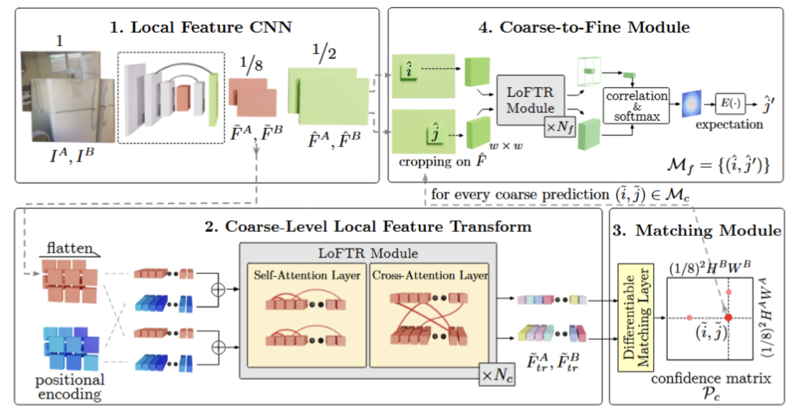
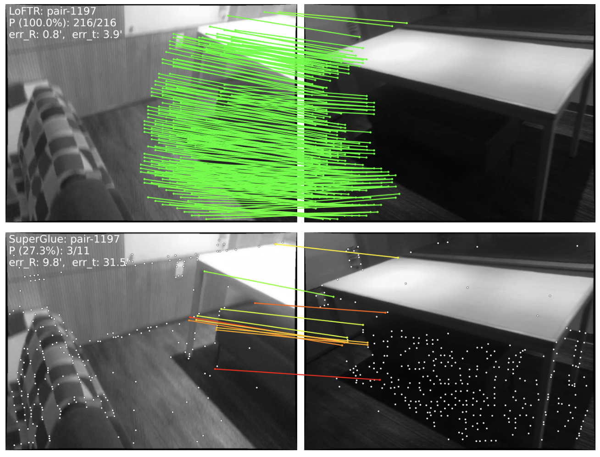

# LoFTR
**标题**：LoFTR: Detector-Free Local Feature Matching with Transformers

## 问题
- 传统局部特征匹配范式（SIFT、SuperPoint+SuperGlue）是**先检测关键点，再计算描述子，最后做匹配**。关键点检测阶段会丢失弱纹理区域（墙面、天空、光滑平面）的信息；一旦关键点漏检，后续匹配完全失效，在低纹理场景、大视角变化下匹配性能很差。
- 已有方法存在什么不足：
1. 两阶段流水线（detector + descriptor）：关键点检测是硬选择，直接丢弃大量像素信息，弱纹理区域几乎没有关键点；
2. SuperGlue 虽然用 Transformer 做匹配，但依然依赖前面检测器输出的稀疏关键点，无法处理无关键点区域；
3. 传统方法在弱纹理、重复纹理、大视角变化场景，内点数量不足，后续几何估计（基础矩阵 / 本质矩阵求解）容易失败。

**痛点**：传统匹配依赖关键点检测器，漏检关键点就没有匹配，弱纹理区域失效。

## 直觉
**不需要显式检测关键点，直接在特征图上做稠密的像素级匹配。**
把整张图像的特征送入 Transformer，利用自注意力建模单图内部上下文，交叉注意力建模两张图之间的跨图关联；在特征层面直接计算匹配，而不是先挑少数关键点。在特征图上区分 “可信匹配对” 和 “无匹配区域”，实现无检测器的局部特征匹配。

## 假设
无检测器、粗到细 Transformer 架构，联合空间与外观建模，在弱纹理场景匹配效果显著优于 SIFT/SUPERPOINT 等基于关键点的方法。

## 方法
LoFTR 可以概括成五步：
>两幅图像
   ↓
CNN + FPN 提取粗粒度特征和细粒度特征
   ↓
LoFTR 模块交替执行自注意力与交叉注意力
   ↓
双 Softmax 或最优传输生成粗粒度可靠匹配
   ↓
在细粒度局部窗口中精化，输出亚像素级匹配

流程图解读
整张图分4个模块：
1. Local Feature CNN（局部特征 CNN 编码器）
输入：两张待匹配图像 ``I^A, I^B``
CNN 主干提取**两档分辨率特征**：
``\tilde{F}^A, \tilde{F}^B``：粗粒度特征图，下采样 1/8 原图尺寸（分辨率低，计算量小，用于粗匹配）
``\hat{F}^A, \hat{F}^B``：细粒度特征图，下采样 1/2 原图尺寸（分辨率更高，用来精细修正匹配坐标）

2. Coarse-Level Local Feature Transform（粗粒度特征变换模块）
粗层用 Transformer 交叉注意力，得到全局特征相关性，预测粗匹配对；
拿 1/8 的粗特征``\tilde{F}^A, \tilde{F}^B``：
1、flatten：把二维特征图摊平成序列 token；
2、positional encoding：加上位置编码，告诉 Transformer 每个特征在图上的空间坐标；
3、**LoFTR Module（Transformer 块，重复``N_c``层）**
    - Self-Attention 自注意力：单张图像内部特征互相交互，学习单图内部上下文；
    - Cross-Attention 交叉注意力：图像 A 特征 和 图像 B 特征互相交互，学习跨图之间的关联。

    输出经过 Transformer 增强后的特征``\tilde{F}_{tr}^A, \tilde{F}_{tr}^B``

>原始 LoFTR 并不是在每一层都重复加入位置编码，而是在主干网络输出后加入一次。论文消融实验表明，采用每层都加入位置编码的 DETR 风格方案，效果反而有所下降。

>通过自注意力，它可以观察整幅图中的门框、墙角、桌面和边缘，并形成这样的上下文描述：“我是位于门框左侧、桌面上方的那块墙面。”这比“我是一块白色区域”更容易匹配。

>LoFTR考虑到直接使用Transformer的成本，因此使用了linear attention：将 Q 和 K 的长度记为 N，特征维度为 D，变换器中 Q 和 K 之间的点积引入了计算成本，计算成本随输入序列长度的平方增长（O（N 2））。即使输入长度被局部特征CNN缩短，直接将Transformer的原版应用于本地特征匹配也是不切实际的。为解决这个问题，我们提议在 Transformer 中使用一种高效的原版注意力层变体。**线性Transformer**[17]提出通过用替代核函数sim（Q， K） = φ（Q） ·φ（K）T ， 其中 φ（·） = elu（·） + 1。该作由图3（c）中的计算图说明。利用矩阵积的结合性性，可以先进行φ（K）T和V的乘法。由于 D ≪ N ，计算成本被降低为 O（N）。

3. Matching Module（粗粒度匹配模块）
输入：经过 Transformer 增强的粗特征
- 构建可微匹配层，生成匹配置信矩阵 ``\mathcal P_c``（就是代价体，记录粗特征图上每一对位置``(i,j)``是匹配点的概率）
- 在置信矩阵上预测粗匹配集合 ``M_c``，得到一组粗略匹配坐标 ``(\tilde i,\tilde j)``

> 这一步得到的匹配点位置精度比较粗糙，但能快速筛出候选匹配对。

> 图像 A、图像 B：
> 
> 
> - ``H^A``：原图 A 的**高度**；``W^A``：原图 A 的**宽度**
> - ``H^B``：原图 B 的**高度**；``W^B``：原图 B 的**宽度**

LoFTR 粗特征是**原图下采样 1/8 倍**得到的特征图：

- 图像 A 粗特征图尺寸：``\boldsymbol{\frac18 H^A \times \frac18 W^A}``
- 图像 B 粗特征图尺寸：``\boldsymbol{\frac18 H^B \times \frac18 W^B}``

4. Coarse-to-Fine Module（Transformer 块，重复``N_c``层）
依据粗匹配的位置，在细特征图上局部窗口内做精细匹配；
> 对**每一个粗匹配结果 ``(\tilde i,\tilde j)\in M_c``，做精细化定位：

（1） 在高分辨率细特征图 ``\hat F^A,\hat F^B`` 上，以粗匹配位置为中心，裁取一小块 w×w 局部特征窗口（cropping）；
（2） 送入另一组 LoFTR Transformer 模块（重复``N_f``层）做局部特征交互；
（3） 计算 correlation 相关性 + softmax，得到局部置信分布；
（4） expectation 期望计算，得到亚像素级的精确匹配坐标 ``\hat j'``；
 最终输出精细匹配集合 ``M_f=\{(\hat i,\hat j')\}``

为什么只算 ``\hat j'\)，不算 \(\hat i``？
因为粗匹配给出了 A 图的位置 ``\tilde i``，细修只去修正 B 图的坐标 ``\tilde j``；A 图的坐标不再修改。把图像 A 作为参考图（anchor），A 点位置固定，只在 B 图上搜索修正匹配点。

**置信度预测 + 匹配生成**：计算特征之间的相似度矩阵，预测每个位置存在匹配的置信度；采用**互近邻匹配（mutual nearest neighbor）**，筛选高置信度匹配对；
输出稀疏的高质量匹配点对（不是全部稠密像素，保留置信度高的匹配），直接供给后端几何求解（RANSAC 求基础矩阵）。

## 方法效果对比

图 1：LoFTR 与 SuperPoint + SuperGlue 的匹配结果对比。**LoFTR 能够在低纹理墙面和重复地板区域给出更多有效匹配。**图源：LoFTR 原论文。

## 结果
1. 在 MegaDepth、ScanNet 数据集上，基础矩阵估计精度显著超过 SuperPoint+SuperGlue；
2. 在弱纹理场景（墙面、光滑平面），能产出大量传统方法完全得不到的匹配对；
3. 推理速度：相比 SuperGlue，在同等精度下有不错的速度；
4. 泛化性：跨数据集泛化能力强，不用针对每个场景微调。姿态估计精度超过传统关键点方法。

## 优点
1. **Detector-free**，摆脱关键点检测器限制，弱纹理区域可以生成匹配；
2. Transformer 全局上下文，对大视角、重复纹理鲁棒性强；
3. 端到端可训练，直接学习特征之间匹配关系；
4. 输出匹配对可以直接对接 SLAM、三维重建、相对位姿估计管线。

## 局限
1. 依赖同模态图像。对大视角变化、跨模态（可见光 / 红外）鲁棒性差；
2. 稠密匹配算力开销大；不丢弃特征，在特征图网格上大量特征之间做 Transformer 注意力 + 全局相关性计算，因此算力开销更大。
3. Transformer 带来计算开销，高分辨率图像推理成本高；
4. 依赖训练数据的分布，极端曝光、严重遮挡场景匹配置信度会下降；

## 未来
1. 修改 LoFTR，适配红外 - 可见光跨模态匹配；
2. 轻量化 Transformer，降低算力，部署在嵌入式 / 机器人端；
3. 引入几何约束（基础矩阵先验）到 Transformer 内部，减少外点；
4. 结合子空间 / 几何学习，进一步提升匹配内点率，降低 RANSAC 耗时。

