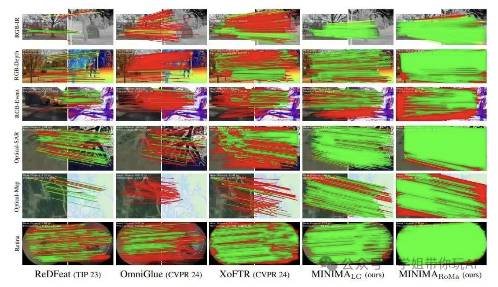
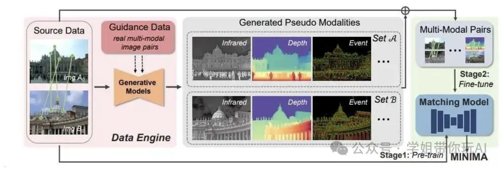
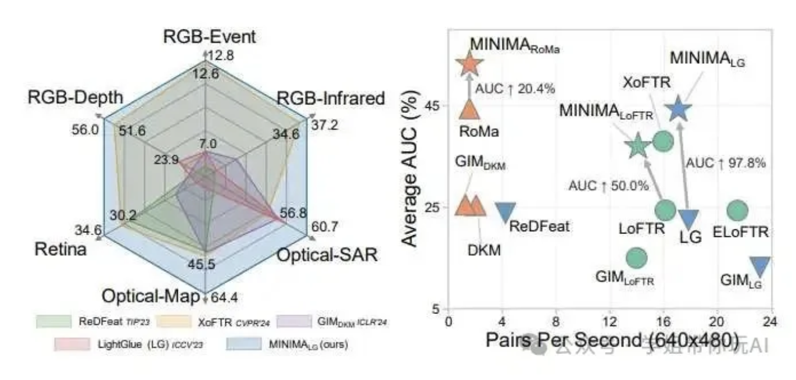
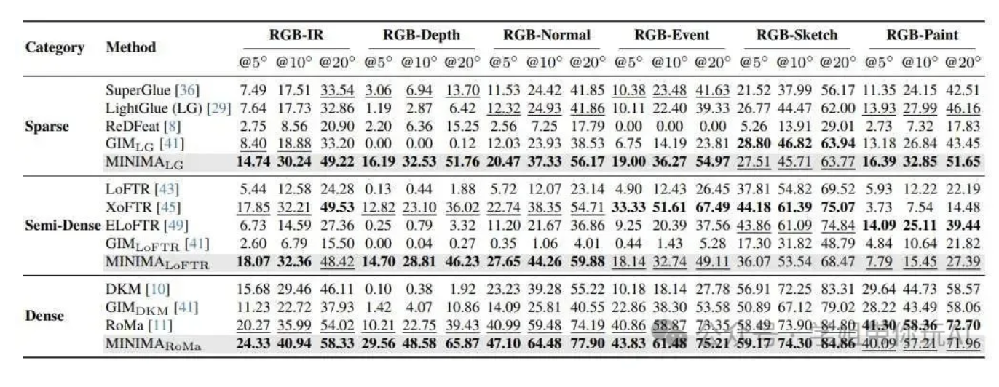

# MINIMA

Modality Invariant Image Matching
## 方法
通过数据扩展的方式，利用生成模型从廉价且丰富的RGB图像数据中生成多种模态的图像数据，从而解决了现有跨模态图像匹配数据集规模小、场景覆盖不足的问题。

真实跨模态图像对的定性结果比较

本图比较了 MINIMA 方法（MINIMALG 和 MINIMARoMa）与其他方法（ReDFeat、OmniGlue 和 XoFTR）在真实跨模态图像对上的匹配结果。图中绘制了每种方法生成的匹配对，红色线条表示误差超出阈值的错误匹配。MINIMALG 和 MINIMARoMa 在稀疏和密集匹配场景下均能生成更多的正确匹配对，显示出更高的匹配精度和更强的泛化能力。

### MINIMA 框架

本图展示了 MINIMA 框架的整体流程，包括数据引擎如何从基础 RGB 数据生成多模态图像匹配数据集，以及如何利用这些数据训练匹配模型以获得跨模态能力。数据引擎由源数据、引导数据和生成模型组成，通过这种方式可以生成丰富的多模态数据，用于训练能够处理各种跨模态匹配任务的统一模型。

整张图分两大块：【Data Engine 数据引擎】 + 【MINIMA 匹配模型两阶段训练】
### 第一部分：Data Engine（左侧，生成伪多模态数据集）

1. **Source Data 源数据**
输入是**多视角 RGB 图像对（ImgA₀、ImgB₀）**，自带已经确定好的 2D 像素匹配真值（图上绿色连线，MegaDepth 这类 RGB 多视图数据集）。

> 
> 原始只有可见光 RGB，没有红外 / 深度 / 事件相机图像。

2. **Guidance Data 引导数据**
少量真实采集的跨模态图像对，用来训练生成模型，学习真实红外、深度、事件图的图像分布，作为风格参考。
3. **Generative Models 生成模型**
把上面的 RGB 图，基于引导数据学到的模态分布，**为每一张 RGB 合成对应的伪模态图像**。
输出 `Generated Pseudo Modalities`（生成伪模态）：

- Set A：ImgA₀ 对应的伪红外、伪深度、伪事件图
- Set B：ImgB₀ 对应的伪红外、伪深度、伪事件图

> 
> 关键点：原图的匹配真值（绿色对应点）直接继承到合成伪模态上。RGB 图上哪两个点匹配，合成红外图里相同空间位置的点天然就是匹配对。
> 👉 由此得到**大量带真值的跨模态图像匹配对 Multi-Modal Pairs**。

### 第二部分：MINIMA 匹配模型 两阶段训练（右侧）

1. **Stage1：Pre-train 预训练**
用原始 RGB 多视图数据做预训练，让模型先学会通用的几何匹配能力。
2. **Stage2：Fine-tune 微调**
使用数据引擎生成的大量**伪多模态配对数据**（RGB ↔ 伪红外 / RGB ↔ 伪深度 / RGB ↔ 伪事件）对匹配网络做微调，学习跨模态之间的几何对应，忽略外观纹理差异。

> 
> 最终得到 MINIMA 通用跨模态匹配模型，可以直接处理红外 - 可见光、事件 - RGB 等多种跨模态匹配任务。

## 创新点
1、MINIMA通过数据扩展的方式，利用生成模型从廉价且丰富的 RGB 图像数据中生成多种模态的图像数据，从而解决了现有跨模态图像匹配数据集规模小、场景覆盖不足的问题。
2、为了支持 MINIMA 框架的训练，作者提出了一种简单而有效的数据引擎，能够自动生成包含多种模态、丰富场景和精确匹配标签的大规模数据集。
3、MINIMA 框架在训练过程中仅使用合成数据，但能够在真实场景中实现零样本跨模态匹配，并且在多个跨模态场景中表现出色，显著超过了现有的模态特定方法。这表明该框架具有强大的泛化能力和适应性。
4、MINIMA（CVPR2025）最核心的创新：**数据引擎 Data Engine**，专门解决跨模态成对训练数据稀缺的痛点

## 方法对比
不同方法在六个真实跨模态图像对数据集上的整体图像匹配准确性和效率

本图展示了多个代表性方法在六个真实跨模态图像对数据集上的平均准确率（AUC）和匹配效率（每秒匹配对数）。左侧显示了每个数据集上各方法的 AUC 值，右侧总结了不同匹配流程（稀疏、半密集和密集匹配）的平均性能。MINIMA 方法（标记为 ⋆）仅使用合成多模态数据进行训练，就能在真实跨模态场景中实现显著的性能提升，同时保持较高的匹配效率。

XoFTR 是单阶段训练，直接用红外 - 可见光配对数据训练；MINIMA 采用两阶段，先 RGB 预训练，再用合成多模态数据微调，泛化性更强，能支持红外、事件、深度多种跨模态任务。

## 实验结果

**表格解读：**
本表展示了在 MINIMA 团队构建的合成数据集上，不同图像匹配方法在多种跨模态任务中的性能表现。
行是方法类别，以及方法
列是跨模态任务+评估指标
一共 6 种跨模态匹配场景：
RGB-IR（可见光-红外）、RGB-Depth（可见光 - 深度图）、RGB-Normal（可见光 - 表面法向图）、RGB-Event（可见光 - 事件图）、RGB-Sketch（可见光 - 素描线稿图）、RGB-Paint（可见光 - 艺术风格绘画图）
每一个任务下面有 3 个指标：`@5°、@10°、@20°`
- 含义：**姿态估计的角度误差阈值**。
- 数值代表：**外参估计正确的准确率（%）**
  - @5°：恢复出来的相机旋转误差小于 5°，算预测正确；
  - @10°：误差小于 10°；
  - @20°：误差小于 20°。
> 这个指标是图像匹配领域标准评测：匹配得到对应点，再用 RANSAC 求解外参；如果算出的相机旋转角度误差小于阈值，判定这一组图像匹配成功。**数字越高，性能越好**。

其中，MINIMA_LG 就是把 MINIMA 的思想套在 LightGlue 稀疏匹配主干上。MINIMA_LoFTR 就是 MINIMA+LoFTR 主干。MINIMA_RoMa 就是 MINIMA+RoMa 主干。
> MINIMA 不是一个全新网络结构，而是**一套数据增强 / 数据引擎方案**，可以直接嫁接在 LightGlue、LoFTR、RoMa 任意匹配主干上，表格里 MINIMA_LG / MINIMA_LoFTR / MINIMA_RoMa 就是这三种组合。

**结论：**
无论是在稀疏、半密集还是密集匹配场景下，MINIMA 方法在多种跨模态匹配任务中普遍优于其他方法，均能获得更高的匹配准确率，这说明 MINIMA 的数据增强和预训练策略有效提升了模型在跨模态图像匹配任务中的泛化能力和性能表现。

