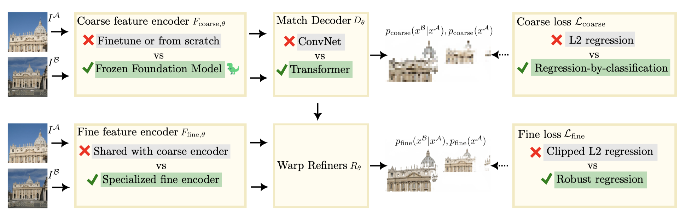

# RoMa
## 问题
**痛点**：
现有粗-细稠密匹配框架存在两大固有缺陷：①从零训练的CNN特征通用语义弱，跨数据集、跨域泛化能力差；②稠密匹配训练中外点、匹配歧义多，常规损失函数梯度崩溃、训练不稳定，无法适配多歧义匹配场景。

## 方法
解决匹配歧义多：网络直接输出**多峰概率分布**，概率分布本身就可以天然表达歧义。
依托大规模预训练模型获取通用视觉能力解决跨域问题
### 框架图

框架图解读：
整体分为**上半部分【粗匹配分支】、下半部分【细匹配分支】，两个分支独立训练**，这也是 RoMa 核心创新之一（粗细解耦训练）。
#### 上半部分：Coarse 粗匹配分支

输入两张图 ``I^A,I^B``

1. **Coarse feature encoder（粗特征编码器）**

> 
> 目的：获取通用语义特征，解决旧 CNN 跨数据集泛化弱的痛点。
   - ❌旧方案：CNN 从头训练 / 微调；
   - ✅RoMa：**冻结基础大模型 Frozen Foundation Model（DINOv2）**。
2. **Match Decoder ``D_\theta`` 匹配解码器**

> 
> Transformer 能建模全局关联，输出**概率分布``p_{coarse}(x^B|x^A)``**，可以是**多峰分布**，显式建模多匹配歧义（一个点可以有多个候选匹配）。
   - ❌旧方案：用卷积 ConvNet；
   - ✅RoMa：Transformer 解码器。
3. **Coarse loss 粗损失**

> 
> 核心解决痛点：大量外点（outlier）场景下，普通 L2 回归梯度容易崩溃。
> 先做分类：预测匹配位置的概率分布（允许多个峰值，表达歧义）；再基于这个分布做回归。
   - ❌旧方案：L2 回归；
   - ✅RoMa：**Regression-by-Classification（分类回归）**

输出：粗尺度匹配概率分布，保留多个候选匹配。

下半部分：Fine 细匹配分支（独立训练，不和粗分支一起联合训练）

输入同样 ``I^A,I^B``

1. **Fine feature encoder（细特征编码器）**

> 
> 分工：粗分支负责全局语义、候选检索；细分支专门学习高分辨率局部细节，负责精准定位、亚像素精度。两者解耦，任务互不干扰。
   - ❌旧方案：粗细分支共享同一个编码器（LoFTR 就是共享骨干）；
   - ✅RoMa：**独立专用细编码器 Specialized fine encoder（可训练 CNN）**
2. **Warp Refiners ``R_\theta`` 形变细化模块**
把粗匹配得到的候选对应关系，做图像特征 warp（特征映射对齐），在局部窗口做精细匹配。
3. **Fine loss 细损失**

> 
> 降低外点的梯度权重，即使存在错误匹配，训练梯度依然稳定，用来做亚像素位置精修。
   - ❌旧方案：Clipped L2（截断 L2 回归）
   - ✅RoMa：**Robust regression 鲁棒回归损失**

> 为什么 roma 的细分支不用 transformer？
> 粗阶段存在**全局长距离依赖，必须 Transformer**。
> 细阶段这个窗口范围极小，**不存在长距离依赖**，不需要跨图全局注意力。

> 为什么使用分类式回归损失？
> L2 强制输出**单个连续坐标**，只能拟合**单峰分布**；
**分类式回归（Regression-by-Classification，分箱 + CE+softargmax）网络输出的是整个窗口内所有 bin 的概率分布，天然可以表达多峰（多个候选位置概率都很高），而不是强行压缩成一个点。**
## 创新点
- 双分支特征架构：冻结DINOv2预训练模型提取通用全局语义特征，搭配可训练CNN提取高精度局部定位特征，**从根源提升跨域泛化能力**
- 提出Regression-by-Classification **分类回归匹配范式**：粗阶段预测多峰概率分布，天然支持一对多多候选匹配，适配场景匹配歧义
- 采用鲁棒回归损失，彻底解决稠密匹配外点过多导致的梯度崩溃、训练不稳定问题
- 粗细模块解耦训练，避免两级任务互相干扰，各自最优收敛

## 结果

## 优点
RoMa具有鲁棒性，即能够在极端变化条件下实现匹配。
兼具强跨域泛化能力与高定位精度，训练稳定性远超传统稠密匹配模型，天然适配存在匹配歧义的复杂场景。

