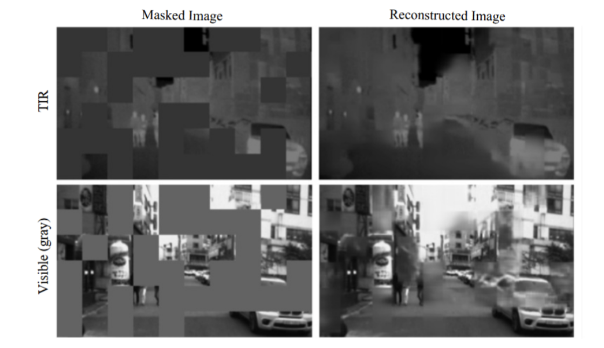
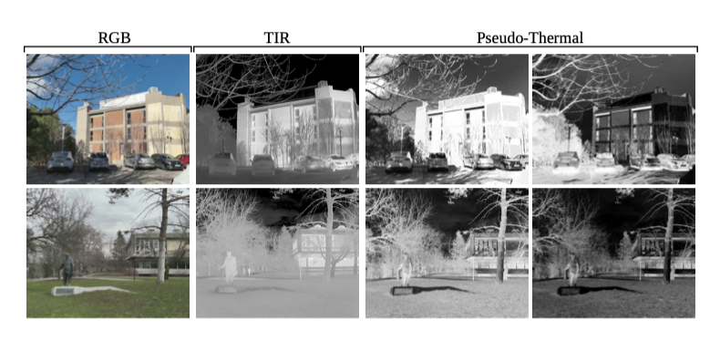
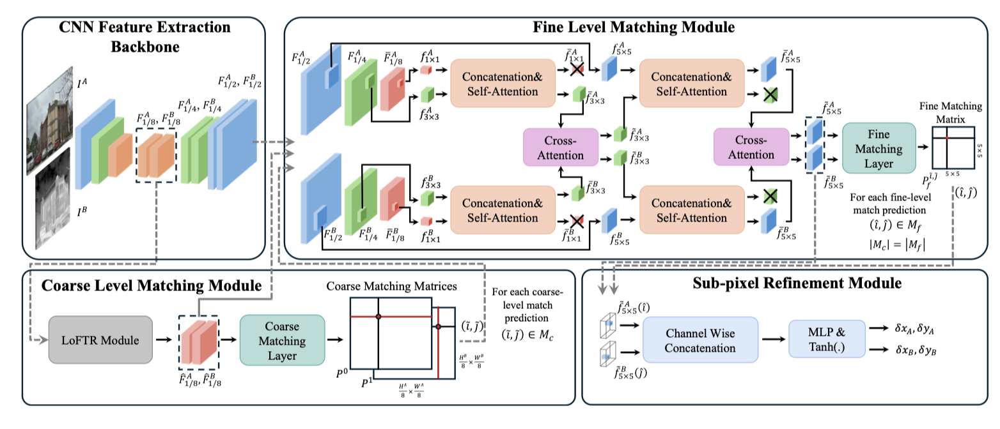
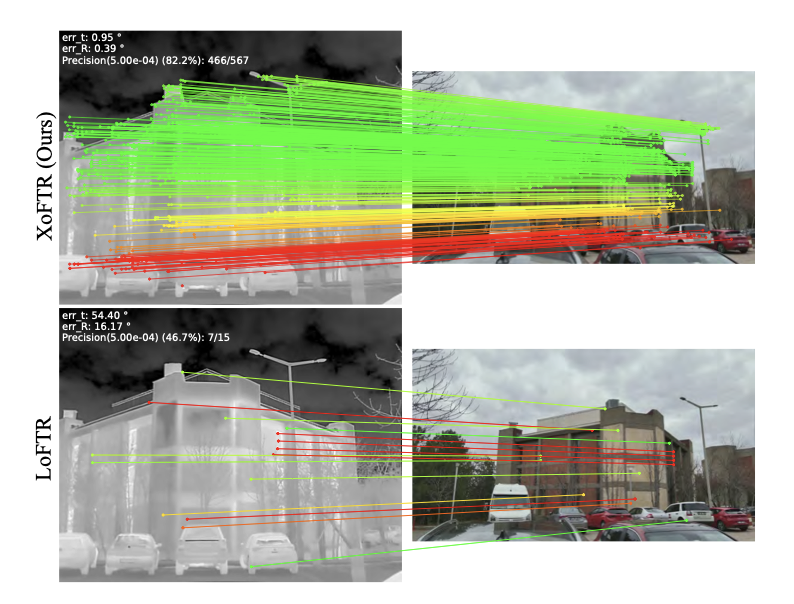

# XoFTR

## 问题
在多模态的情况下，可见光捕获反射光，而红外图像捕获热辐射 。这导致它们在纹理、强度上存在巨大的非线性差异，传统的方法往往就力不从心，XoFTR就是来解决这个问题的。
**痛点**：LoFTR 原版 MNN 一对一约束，在红外 - 可见光跨模态场景，容易把真实匹配过滤掉，召回率低。

## 方法
### 训练策略
训练策略：用“预习”和“扩充”弥补模态差异
阶段一：预训练（MIM Pre-training）
XoFTR借鉴了掩码图像建模（Masked Image Modeling, MIM）的思路，让模型在看到真实可见光-热红外图像对时，就先学习如何适应两者之间的特征差异 。

>为什么要去做MIM？
可见光和热红外，**像素亮度、纹理完全不一样（模态鸿沟）**；但是**物体的轮廓、边缘、空间几何布局是共通的**。
MIM 掩码预训练的逻辑：
（1） 随机 mask 掉大片图像块，**把模态特有的外观细节（亮度、纹理）直接屏蔽掉**；
（2） 强迫 CNN 骨干只能依靠剩下的边缘、轮廓信息，去重建被遮挡区域；
（3） 模型被迫去学习**跨模态共享的几何结构**，而不是学习可见光 / 热红外独有的亮度、纹理特征。

阶段二：微调与伪热红外图像增强（Fine-tuning with Augmentation）
为了在缺乏大型跨模态数据集的情况下提升泛化能力，XoFTR使用一种基于余弦变换（Cosine Transform）的图像增强方法，将可见光图像转化为“伪热红外图像” 。
 目的： 这种增强让模型在微调阶段能接触到更多具有热红外特性的数据，从而更好地适应模态变化 。
 

### 匹配分配：突破“一对一”限制
LoFTR在粗匹配阶段（1/8 分辨率）默认使用MNN来保证匹配的唯一性。但在跨模态图像中，可见光和红外图像的分辨率、视野、尺度差异很大，**这种严格的一对一约束会把大量正确匹配过滤掉**。放宽约束后可以召回更多候选，宁可暂时多保留一些冗余匹配，也不漏掉正确的配对，这是典型的「先召回再精筛」思路。

XoFTR通过调整匹配的分配逻辑，允许“一对多”或“多对一”的软分配 ，以增强鲁棒性。

粗匹配阶段特意允许一对多 / 多对一，细匹配阶段逐步筛选收敛，最终亚像素回归阶段输出严格的一一对应结果。

对比LoFTR：
LoFTR 原版粗匹配使用**双向互近邻（MNN）**约束，只有互为最优的点对才会被保留，输出严格一对一的匹配集。
XoFTR 在这一步做了核心修改：
不再强制双向互近邻，而是分别计算「A→B 的单向最优匹配」和「B→A 的单向最优匹配」，取两者的并集作为粗匹配结果 ``M_c``；
这就天然允许：一个 A 点对应多个 B 点（一对多）、多个 A 点对应同一个 B 点（多对一）。

### XoFTR框架图

网络框架图解读：
XoFTR 由四个模块组成：
1. CNN 主干网络(CNN Feature Extraction Backbone)，
输入可见光``I^A``、热红外``I^B``；CNN 输出多尺度特征：
- ``F_{1/2},F_{1/4},F_{1/8}``，分别是原图 1/2、1/4、1/8 下采样特征图。
> 👉 **MIM 就是作用在这个 CNN 骨干上做预训练：**
> 预训练阶段：对 RGB 和 TIR 图像做掩码，让 CNN 骨干去预测被 mask 掉的特征，强迫骨干学习跨模态共有的几何轮廓，过滤颜色 / 亮度模态特有外观。靠 MIM 自监督预训练来缓解跨模态鸿沟。
> **推理阶段：mask 分支直接移除，就只剩下普通 CNN 特征提取，所以流程图不画 MIM。**

2. 粗粒度匹配模块（Coarse Level Matching Module）
- 输入：1/8 尺度粗特征 ``\hat F_{1/8}^A,\hat F_{1/8}^B``
- 内部是**改造版 LoFTR 模块**，做全局交叉注意力，输出粗匹配矩阵 ``P^0,P^1``；
- 输出粗匹配集合 ``M_c=\{(\tilde i,\tilde j)\}``，也就是粗匹配候选点。

    负责对特征进行相关性计算，并在 1/8 尺度上生成粗粒度匹配预测，支持多对一和一对多的匹配分配；

3. 细粒度匹配模块（Fine Level Matching Module）（XoFTR 相比于 LoFTR 最大改动）
LoFTR 原版：只在粗匹配后做一次局部窗口；XoFTR 做**多尺度局部 Transformer**。
(1) 拿多尺度特征``F_{1/2},F_{1/4},F_{1/8}``，分别 concat 拼接，送入**Self‑Attention 自注意力**；
(2) 做**Cross‑Attention 交叉注意力**，交换 A、B 图局部信息；
(3) 逐级上采样，得到 ``5\times5`` 的局部窗口特征 ``\tilde f_{5\times5}^A,\tilde f_{5\times5}^B``；
(4) 送入 Fine Matching Layer，输出细匹配矩阵，得到细匹配集合 ``M_f``。

> 注意：XoFTR 这里**粗‑细模块全部保留 Transformer 注意力，不是简单卷积**；并且``|M_c|=|M_f|``，粗匹配多少对，细匹配就处理多少对。

> 拼接的是什么？
> 拼接的是多尺度特征，把三个尺度特征，通过上采样 / 下采样对齐到**同一个空间尺寸**，然后在**通道维度做 concat 拼接**。
> 也就是：把多尺度的信息合并到同一个特征向量里，**一个特征点同时拥有粗、中、细三层尺度信息**。
> 公式理解：``F_{concat}= \text{Concat}(F_{1/2},F_{1/4},F_{1/8})``，通道数叠加，空间 H、W 不变。
跨模态红外 - 可见光图像，单尺度特征容易丢失信息；拼接之后，**每个特征 token 同时携带局部细节 + 全局上下文，增强跨模态的鲁棒性**。

>3×3、5×5，是**特征图的空间网格尺寸**（不是原图像素，是特征图上的格子）

>红色和绿色立方体上的叉号代表上采样，核心作用是对齐空间维度，让不同尺寸的特征能在通道维度拼接融合。输入 1：`3×3×C₁`（上采样后的全局特征）输入 ，2：`3×3×C₂`（原始 3×3 局部特征），输出：`3×3×(C₁+C₂)`
4. 亚像素精化模块（Sub‑pixel Refinement Module）
> 原始 LoFTR：只修正 B 图坐标；XoFTR**双向回归，同时修正 A、B 两张图的偏移**arXiv。

（1）取出细匹配位置对应的局部 5×5 特征 ``\tilde f_{5\times5}^A(\hat i),\tilde f_{5\times5}^B(\hat j)``
（2）Channel‑Wise Concatenation 通道拼接；
（3）MLP+Tanh 回归出偏移量：``\delta x_A,\delta y_A``（A 图偏移）、``\delta x_B,\delta y_B``（B 图偏移）
（4）把偏移加到粗坐标上，得到**双向亚像素匹配坐标**。

采用回归机制对细粒度匹配预测进行亚像素级精化，避免一幅图像中的一个点与另一幅图像中的多个点发生匹配。

>XoFTR引入掩码图像建模预训练，并结合伪热红外图像增强进行微调，以有效应对模态差异；

>XoFTR改动点：
不立刻做MNN硬筛选，保留一对多/多对一候选集合，先把全部高概率候选都留下来，交给后面细匹配模块再去甄别，提升跨模态的召回。

对比LoFTR模块
|模块| LoFTR原版|XoFTR|
|---|----|----|
|骨干预训练|普通 RGB 预训练| MIM 跨模态掩码预训练（训练阶段）|
|细匹配|单尺度局部窗口 Transforme|多尺度局部 Self‑Attn+Cross‑Attn 细匹配模块|
|亚像素精修|只修正 B 图坐标|双向回归，同时修正 A、B 两张图的亚像素偏移|
|数据增强|普通增强|增加伪热红外图像合成增强|

我们的损失函数由三部分组成：粗粒度匹配损失、细粒度匹配损失和亚像素级优化损失。

## 方法效果对比

我们的XoFTR在可见光与热成像图像对上的性能显著优于LoFTR。图中仅显示经RANSAC筛选后的内点匹配结果，且将极线误差低于5×10⁻⁴的匹配以绿色标出。

消融实验进一步证实各模块贡献：
去除掩码预训练或伪热图增强均导致性能大幅下降；
仅保留一对一粗匹配会削弱大尺度变化下的鲁棒性；
取消子像素细化或1/2尺度二次阈值筛选亦明显降低匹配精度；
而引入绝对位置偏置则有助于提升局部几何一致性。
此外，XoFTR在A5000 GPU上处理640×512图像耗时116ms，略高于LoFTR（102ms），但精度提升显著，具备良好的实用性平衡。